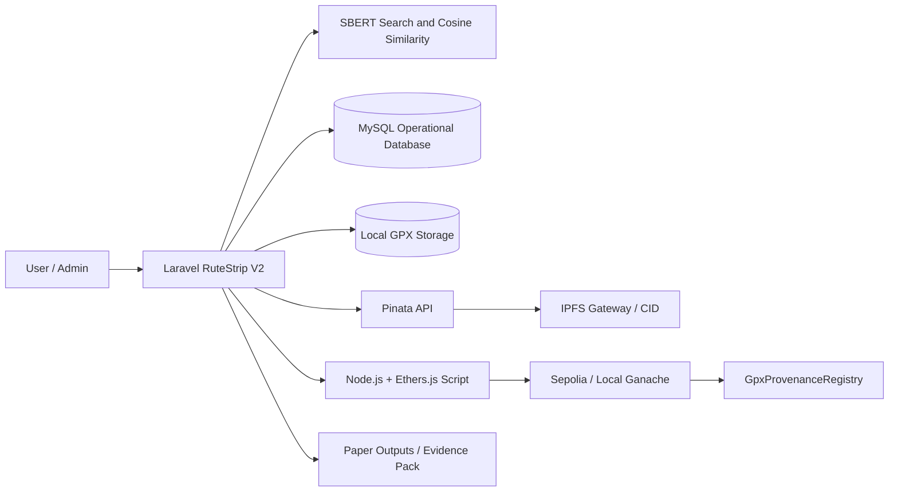
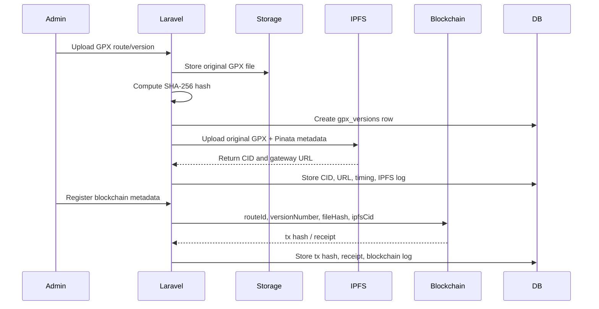
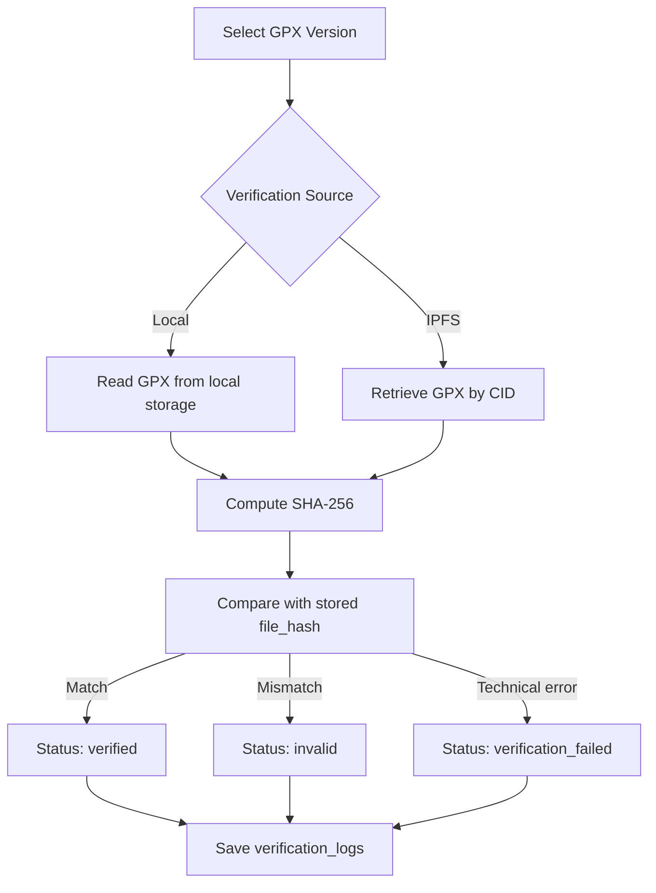

# Visual Deliverables for Paper

Dokumen ini menyiapkan bahan visual yang disebutkan PRD. Diagram Mermaid dapat dirender di Markdown viewer yang mendukung Mermaid, lalu diekspor sebagai gambar untuk naskah.

## 1. System Architecture

## 2. GPX Provenance Flow

## 3. Integrity Verification Flow

## 4. Recommended Screenshots

1. `/search` or search results with GPX trust badge.
2. `/routes/{id}/provenance` showing version history, hash, CID, blockchain tx, and download button.
3. `/admin/paper-outputs/provenance` showing before/after table and evaluation tables.
4. `/admin/paper-evidence-pack` showing checklist, latest IPFS evidence, latest blockchain evidence.
5. Sepolia transaction page for the registered GPX metadata transaction.
6. `/admin/paper-readiness` showing readiness score and criteria.

## 5. Figure Captions

1. **System architecture of trustworthy hiking route recommendation with GPX provenance.**
2. **GPX provenance workflow from upload, hashing, IPFS pinning, and blockchain metadata registry.**
3. **Integrity verification workflow using SHA-256 comparison from local storage and IPFS retrieval.**
4. **Recommendation result enriched with GPX trust indicator without changing cosine similarity ranking.**
5. **Paper evidence pack containing IPFS CID, Sepolia transaction hash, verification log, and readiness checklist.**
